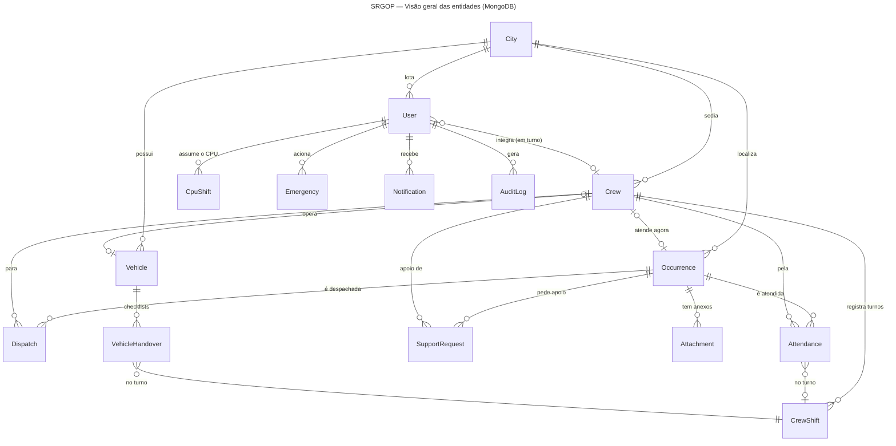
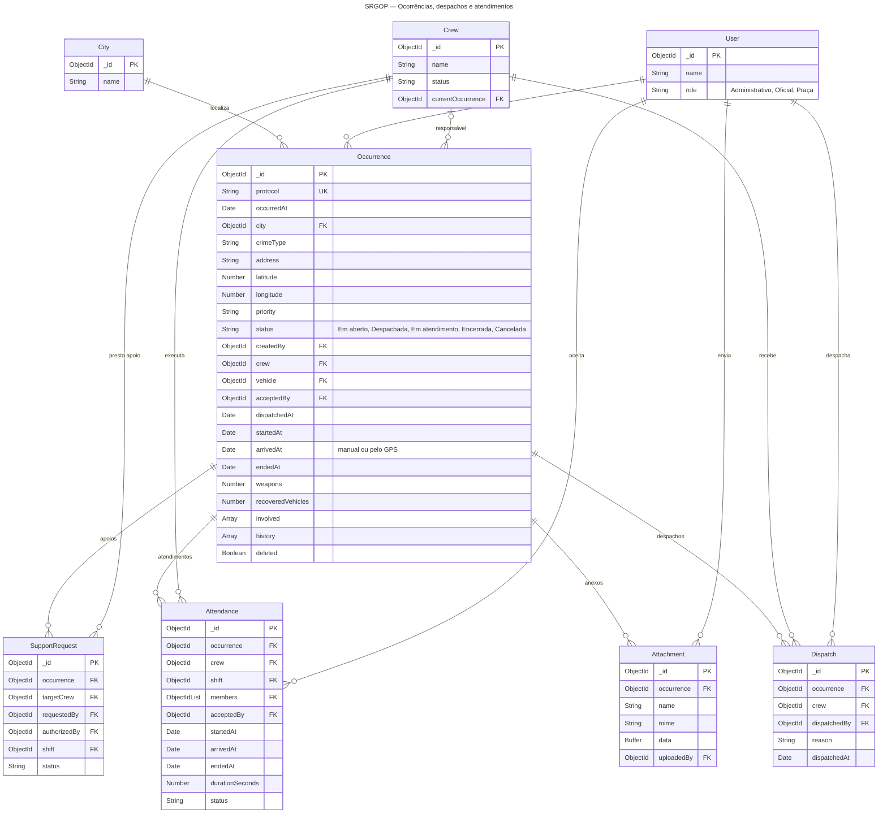
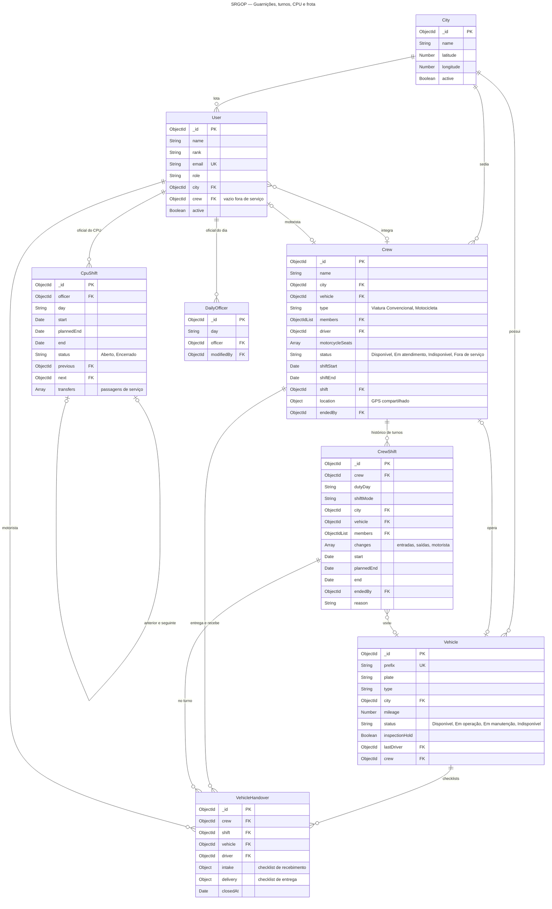
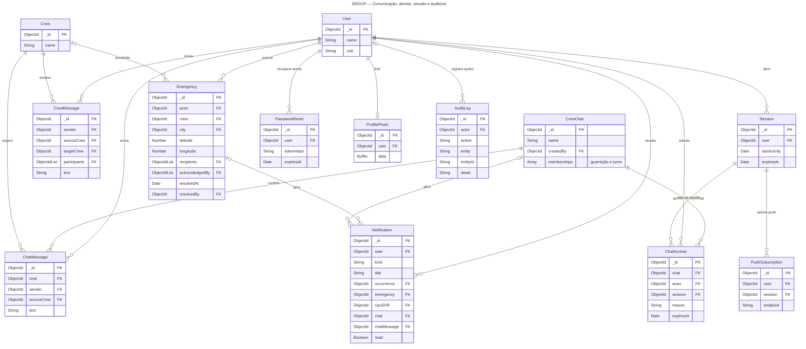
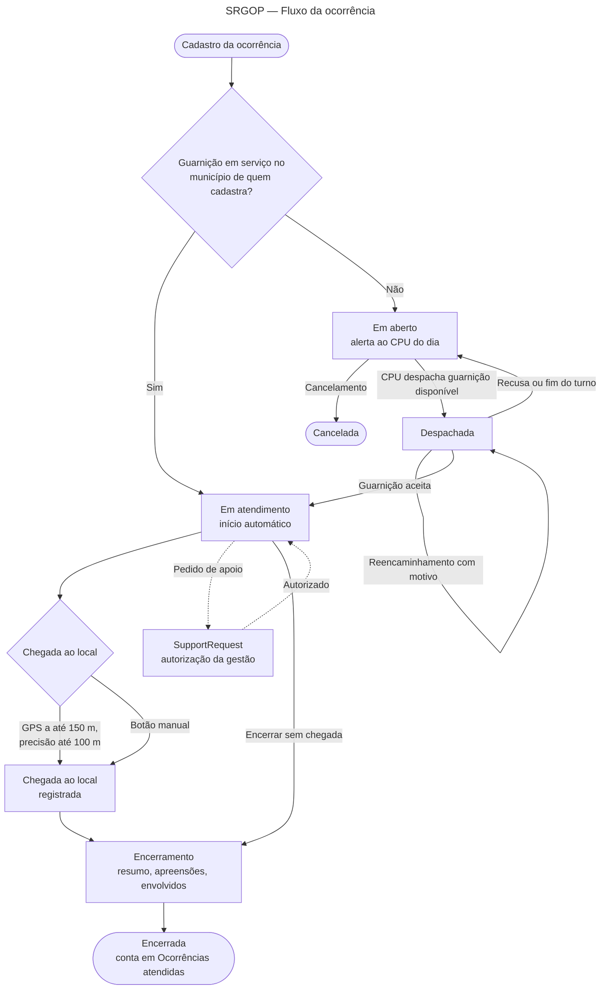
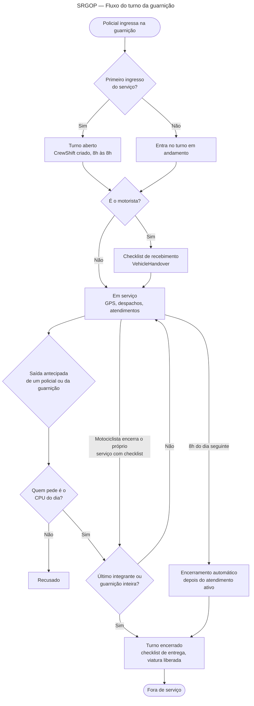

# Diagramas do SRGOP

Gerados a partir dos schemas Mongoose em `backend/models` e das regras em `backend/services`
(estado de 19/11/2026). As imagens PNG desta pasta foram capturadas de `visualizar.html`
(abra no navegador e use `?n=1` a `?n=6`); ao mudar um diagrama aqui, atualize também a lista
`DIAGRAMS` daquela página.

| Imagem | Conteúdo |
| --- | --- |
| `01-er-visao-geral.png` | Todas as entidades principais e como se ligam |
| `02-er-ocorrencias.png` | Ocorrência, despacho, atendimento, apoio e anexos, com campos |
| `03-er-turnos-frota.png` | Guarnição, turno, CPU, viaturas e checklists, com campos |
| `04-er-comunicacao-seguranca.png` | Chat, mensagens, emergência, notificações, sessão e auditoria |
| `05-fluxo-ocorrencia.png` | Ciclo de vida da ocorrência, incluindo chegada pelo GPS |
| `06-fluxo-turno.png` | Turno da guarnição e encerramento antecipado pelo CPU do dia |

## 1. Visão geral das entidades

## 2. Ocorrências, despachos e atendimentos

## 3. Guarnições, turnos, CPU e frota

## 4. Comunicação, alertas, sessão e auditoria

Coleções sem relacionamento (configuração e proteção): `SystemSetting`, `InstitutionLogo`,
`LoginThrottle` e `OccurrenceSequence` (numeração de protocolos).

## 5. Fluxo da ocorrência

## 6. Fluxo do turno da guarnição

